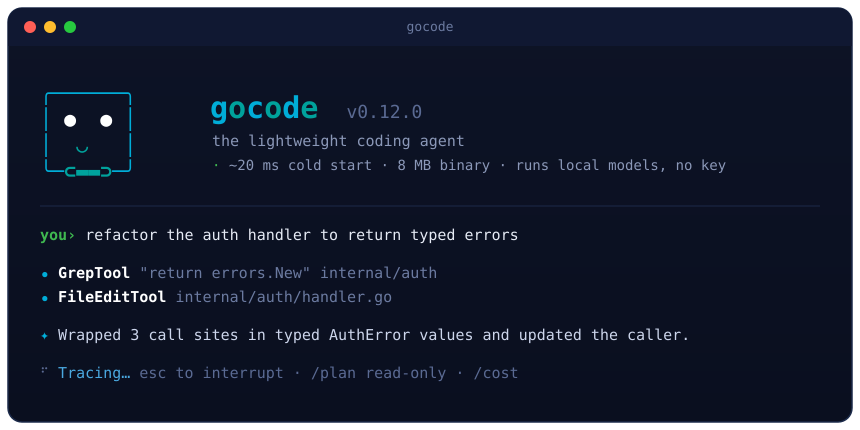
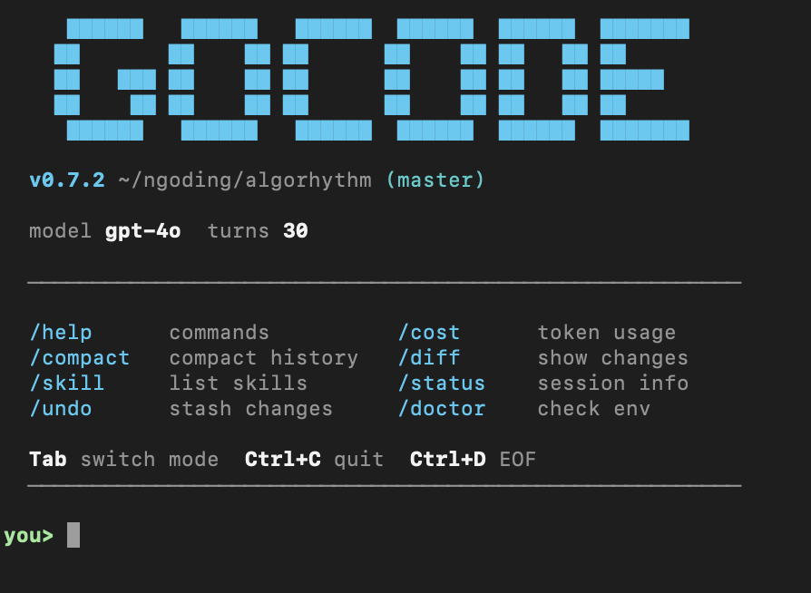

<p align="center">
  
</p>

<p align="center">
  
  
  
  
  
  
  
  
  
</p>

<h1 align="center">gocode</h1>
<p align="center"><strong>The open-source Claude Code alternative. Built in Go. Works with any model.</strong></p>

<p align="center">
  
</p>

<p align="center">
  One binary. Zero dependencies. Any model, including the one on your laptop.<br/>
  A small Go binary that starts in milliseconds and tells you what each model actually costs.
</p>

<p align="center">
  <code>go install github.com/AlleyBo55/gocode/cmd/gocode@latest</code>
</p>

---

## Start in 60 seconds

Pick the path that matches what you have. Each one is a single command away from a working agent.

**Nothing. No account, no key.** Install [Ollama](https://ollama.com), then:

```bash
ollama pull qwen2.5-coder:7b
gocode                      # finds Ollama, uses your local model, says so
```

**One key for every hosted model.** Get one at [openrouter.ai/keys](https://openrouter.ai/keys):

```bash
export OPENROUTER_API_KEY=sk-or-...
gocode --model anthropic/claude-sonnet-4-6
```

**A provider key you already have:**

```bash
export ANTHROPIC_API_KEY=sk-ant-...   # or OPENAI_API_KEY, GEMINI_API_KEY, GROQ_API_KEY, ...
gocode
```

Two commands worth knowing before you trust a model with your code:

```bash
gocode doctor --model qwen2.5-coder:7b   # can it stream, follow a system prompt, call tools, call several at once?
gocode chat --max-cost 2                 # hard stop at $2 of estimated spend, before the next tool runs
```

If you type `gocode` with nothing set up, it prints exactly these three paths instead of an error.

---

## Why gocode

We loved what Claude Code did for terminal AI coding. We wanted something faster, model-agnostic, and dependency-free.

So gocode is an independent implementation in Go, inspired by the best ideas in terminal AI agents and written with its own architecture: the provider layer, the agent runtime, the tool executor, the orchestrator, the memory system, the planning engine.

The result is a single binary of roughly 8 MB that starts in milliseconds, works with 200+ models across 11 providers, and ships with capabilities most agents do not attempt.

---

## What makes gocode different

### Any model, your choice

Most terminal agents lock you into one provider. gocode works with all of them: Claude, GPT, Gemini, Grok, DeepSeek, Mistral, Llama, and local models. Set one env var and go, or use OpenRouter and reach every model with a single key.

### A team of agents, not just one

gocode runs an orchestrator with specialist sub-agents that plan, coordinate, and delegate to each other. Up to 5 concurrent background agents, each with its own model preference and tool permissions.

### Memory that persists, and dreams

Cross-session memory remembers your preferences, project conventions, and architectural decisions. A dream system consolidates and prunes that memory during idle periods, keeping what matters and dropping what does not.

### IDE-level tooling in your terminal

Real LSP integration (actual renames and go-to-definition, not regex). AST-grep for structural code search. A WebSocket bridge to VS Code, Cursor, Kiro, and Antigravity. Not a chatbot with file access, an agent with IDE capabilities.

### Instant, always

Starts in milliseconds. Roughly an 8 MB binary. No runtime dependencies: no Python, no Node, no virtual environments. Run `go install` and you are done.

### Cheap where it counts

The fixed part of every request is small: about 1,700 tokens of system prompt plus twelve tool schemas. On Anthropic that prefix and the conversation so far are prompt-cached, so a 30-turn tool loop pays full price for them once, not thirty times. Tool output is capped at 40 KB per call and file reads are paged, so one stray `cat` cannot flood the context. `/cost` shows the split per model with cache reads included, and `--max-cost` puts a dollar ceiling on a session.

---

## What's new

### v0.12.0, a face of its own

The terminal UI gets gocode's own identity: a two-tone blue gopher welcome screen, its own rotating waiting words, and quieter tool lines. Output is now plain text when it is not talking to a terminal (a pipe, a file, `NO_COLOR`, or `TERM=dumb`), so redirected logs no longer carry escape codes. A lone mistyped command such as `/stauts` suggests the nearest real command instead of spending a model turn.

### v0.11.0, MCP that talks to real servers, and a plan mode that plans

The MCP client now speaks the stdio standard (newline-delimited JSON) by default, so standard MCP servers and gocode's own `gocode mcp-serve` connect without extra config, with a startup timeout so a silent server cannot hang the session. `/plan` became a real read-only mode: the agent reads, searches, and fetches, while edits, shell, MCP tools, and sub-agents stay blocked until you leave it. Also shipped: `/goal` persistent objectives with a token budget, and a built-in [REA](https://github.com/morluto/rea) integration with model-matched investigator workflows (see [REA Mode](#rea-mode-reverse-engineering-pipeline)).

### v0.10.0, the any-model release has to actually work with any model

The provider layer, the permission boundary, and the agent loop got their first tests, and what the tests found got fixed: streams that broke mid-reply were recorded as complete, fallback never fired for rate limits, streamed token counts were zero, and a trusted `git *` approved `git status; rm -rf /`. New: a loop guard that stops a model repeating the same failing tool call, `--max-cost` for unattended runs, a per-model cost ledger behind `/cost`, `gocode doctor --model X`, zero-config local models through Ollama or LM Studio, and an opt-in eval harness under `evals/`.

### Earlier

- **v0.9.0:** dream memory system, deep planning that delegates to the strongest model, vim keybindings, a cron scheduler, an agent swarm, a WebSocket IDE bridge, PDF reading, output styles.
- **v0.8.0:** the universal model layer, 200+ models, 11 providers, local inference, persistent memory, task management, web search.
- **v0.7.0:** full terminal UI, multi-agent orchestration, model fallback, slash commands, skills, plugins, LSP, AST-grep.

> **[Full changelog](CHANGELOG.md)**

---

## Modes

| Mode | What it does | How you use it |
|------|-------------|----------------|
| **Agent (REPL)** | Line-based chat. The default. | `gocode chat` |
| **Agent (TUI)** | Full terminal UI with split panels, diff viewer, themes. | `gocode chat --tui` |
| **API server** | Headless HTTP REST API for remote clients. | `gocode serve` |
| **MCP server** | Plug into Cursor, Kiro, VS Code, Antigravity, or Claude Desktop. | `gocode mcp-serve` |
| **REA** | Reverse-engineering pipeline; auto-activates a model-matched role when REA tools are connected. | `gocode rea setup`, then `gocode chat` |

---

## REA Mode, reverse-engineering pipeline

gocode integrates with [REA](https://github.com/morluto/rea) ("Reverse Engineer Anything"), an external CLI and MCP server that gives the agent 234 tools for inspecting binaries, Electron and JS apps, .NET, APKs, firmware, and websites. gocode does not bundle REA. You install it once, and gocode launches it as a stdio MCP subprocess on demand.

**Setup (one time):**

```bash
gocode rea setup     # detects REA and a compatible node, writes .gocode/mcp.json
gocode rea status    # verifies the live MCP handshake, prints the tool count
```

After setup, `gocode chat` auto-connects to REA and exposes its tools as `mcp_rea_*`. That is the whole integration; there is no separate mode flag.

**The model-matched part.** When REA tools are connected, gocode appends a REA workflow to the system prompt chosen by which model is active. This encodes a three-model pipeline, investigate then challenge then rebuild, where each model plays to its strength:

| Active model | Role injected | The discipline it enforces |
|--------------|---------------|----------------------------|
| **Claude Opus** | Deep Investigator | Trace one feature end to end. Every finding is a row: observation, inference, limitation, unknown, target hash, evidence id. **No evidence, no claim.** |
| **Grok** | Adversarial Reviewer | Break the explanation, do not extend it. Mark every conclusion SUPPORTED, WEAK, or UNSUPPORTED. **Assume it is wrong.** |
| **GPT, Codex, o-series** | Rebuilder and Verifier | Build only from CONFIRMED rows. Fill `PARITY_MATRIX.md`: input, original, mine, match. **Unknown never reaches the code.** |

A model with no defined workflow (Gemini, Llama, DeepSeek, and so on) gets no injection even with REA tools present. Run all three in sequence by switching models: investigate with Opus, challenge with Grok, rebuild with GPT.

**The boundary is part of the feature.** Every REA workflow prompt carries the same limit: analyze only software you are authorized to inspect. No DRM bypass, no credentials, no anti-cheat, no proprietary code. REA is a tool for understanding systems you own or are licensed to examine.

**One honest caveat.** REA is an external 178 MB Node tool with its own Node version pin (currently `^22.23.4 || ^24.22.1 || >=26.12.1`). gocode's MCP client talks to it over newline-delimited JSON, the MCP stdio standard and gocode's default for every server since v0.11.0. `gocode rea status` is the source of truth for whether the integration is live on your machine.

---

## Supported models

Every model. Every provider. One binary. No lock-in. Four native providers, seven proxy services, local inference, 200+ models. Set one env var and go.

| Provider | Highlights | Env var |
|----------|-----------|---------|
| **Anthropic** | Claude Opus 4.6, Sonnet 4.6, Haiku 4.5 | `ANTHROPIC_API_KEY` |
| **OpenAI** | GPT-5.4, o3, o4-mini, Codex | `OPENAI_API_KEY` |
| **Google** | Gemini 3.1 Pro, Gemini 3 Flash | `GEMINI_API_KEY` |
| **xAI** | Grok 4.20 Beta, Grok 3 | `XAI_API_KEY` |
| **DeepSeek** | DeepSeek Chat, R1 Reasoner, Coder | `DEEPSEEK_API_KEY` |
| **Mistral** | Mistral Large, Codestral, Pixtral | `MISTRAL_API_KEY` |
| **Groq** | Llama 3.3 70B at high throughput | `GROQ_API_KEY` |
| **Together AI** | Llama 405B, Qwen 72B Turbo | `TOGETHER_API_KEY` |
| **Novita AI** | Llama 3.3 70B, DeepSeek V3/R1, Qwen 2.5 | `NOVITA_API_KEY` |
| **OpenRouter** | 200+ models, one API key | `OPENROUTER_API_KEY` |
| **Azure OpenAI** | Enterprise GPT deployments | `AZURE_OPENAI_API_KEY` |
| **Local (Ollama / LM Studio)** | Run any model on your machine, detected automatically | none (`OLLAMA_HOST` for a non-default address) |

```bash
gocode chat --model sonnet              # Claude
gocode chat --model gpt5                # GPT-5.4
gocode chat --model deepseek            # DeepSeek
gocode chat --model groq-llama          # Llama on Groq
gocode chat --model qwen2.5-coder:7b    # any model installed in Ollama, no key, no config
gocode chat --goal coding               # auto-pick the best coding model you have a key for
```

### One key, every model

Don't want to manage 11 keys? Set one OpenRouter key and reach every model from every provider.

```bash
export OPENROUTER_API_KEY=sk-or-your-key

gocode chat --model openai/gpt-4o                         # GPT-4o
gocode chat --model anthropic/claude-sonnet-4-20250514    # Claude Sonnet
gocode chat --model google/gemini-2.5-pro-preview         # Gemini
gocode chat --model x-ai/grok-3                           # Grok
gocode chat --model deepseek/deepseek-chat                # DeepSeek
gocode chat --model meta-llama/llama-3.3-70b-instruct     # Llama
gocode chat --model mistralai/mistral-large-latest        # Mistral
```

One binary, one key, every model. Get your key at [openrouter.ai/keys](https://openrouter.ai/keys).

> **[Full model list, 200+ models](docs/supported-models.md)**

---

## The full feature set

### Multi-agent orchestration
- Four built-in sub-agent profiles: coordinator, deep-worker, planner, debugger
- Up to 5 concurrent background agents with independent contexts
- Agent-to-agent messaging: every spawned agent joins the swarm under its own name, can message `main` or a sibling with `send_agent_message`, sees `list_agents`, and reads its inbox at the start of each turn; background agents report their result to `main` when they finish
- Category-based model routing (deep, quick, visual, ultrabrain)
- Automatic model fallback on rate limits and server errors

### Planning and strategy
- `/plan`: toggle read-only plan mode. The agent reads, searches, and fetches, then hands you a numbered plan; edits, shell, MCP tools, and sub-agents stay blocked until you run `/plan` again
- `/ultraplan`: deep planning with the strongest available model (background, 30-minute timeout)
- Structured plan output with scope analysis and step-by-step blueprints

### Memory and persistence
- Cross-session memory with 3 scopes and team sync
- Dream system: autonomous memory consolidation (orient, gather, consolidate, prune)
- Session persistence and resume (`-c` and `-r` flags)
- Memory aging and relevance-based pruning

### IDE-level tools
- LSP integration: real renames, go-to-definition, find-references, diagnostics
- AST-grep: structural code search and rewrite (Go, JS, TS, Python)
- Hash-anchored file I/O: CRC32 line hashes prevent stale edits
- Auto-format on save (gofmt, prettier, black, rustfmt)

### IDE bridge
- WebSocket server for bidirectional IDE communication
- Works with VS Code, Cursor, Kiro, Antigravity
- Permission forwarding and real-time response streaming
- Multiple concurrent IDE connections

### Terminal UI
- Full bubbletea TUI with split panels (chat and git diff viewer)
- Four built-in themes: golang, monokai, dracula, nord
- Custom themes via `.gocode/theme.json`
- Custom keybinds via `.gocode/keybinds.json`
- Vim keybindings: full normal, insert, and visual modes with motions, operators, text objects
- Color-aware output: plain text when piped or redirected, or when `NO_COLOR` is set

### MCP server and client
- Full MCP protocol compliance (server mode for IDEs)
- MCP client: connect to external MCP servers for extended capabilities
- 14+ built-in tools
- Dual transport: stdio and HTTP

### Skills system
- 16 built-in skills (see below)
- Custom skills via `.gocode/skills/` JSON files
- Mid-session skill switching with `/skill`
- Skills with MCP server configs auto-start child processes

### Scheduling and automation
- Cron scheduler with 5-field expressions
- Background agent execution on schedule
- Persistent schedules in `.gocode/cron.json`
- GitHub Actions integration (`gocode-action` for PR review and issue implementation)

### Session and git
- Git checkpoints with `/undo N` and per-session refs
- Git worktree tools for parallel branch work
- `/diff`: see changes made this session
- `/review`: agent self-reviews its own changes
- `/commit`: auto-generated commit messages

### More
- PDF reading (text extraction, 50 MB limit, pure Go)
- Web search (DuckDuckGo, no API key needed)
- Web fetch (URL content extraction)
- Structured JSON output with `--output-format json` and `--output-schema`
- Output styles (concise, verbose, markdown, minimal) plus custom styles
- Notebook editing (Jupyter .ipynb cell-level operations)
- Tmux persistent terminal sessions
- Plugin system with a hook pipeline
- Migrations system for automatic config upgrades
- 25+ slash commands
- 23 CLI subcommands

---

## Skills, expertise on demand

One flag, and your agent becomes a specialist.

```bash
gocode chat --skill golang-best-practices    # writes Go like a senior engineer
gocode chat --skill nothing-design           # designs like Teenage Engineering
gocode chat --skill loop                      # autonomous keep-going mode
```

### 16 built-in skills

| Skill | What it does |
|-------|-------------|
| `git-master` | Atomic commits, interactive rebase, clean history |
| `frontend-ui-ux` | Design-first UI development, accessibility, semantic HTML |
| `nothing-design` | Nothing-inspired monochrome design: Swiss typography, OLED blacks |
| `golang-best-practices` | Idiomatic Go: code style, error handling, testing, naming |
| `clone-website` | Pixel-perfect website cloning: extract CSS, rebuild in Next.js |
| `nextjs-best-practices` | Next.js 15+ patterns: RSC, async APIs, data fetching |
| `react-best-practices` | React performance: waterfalls, bundle size, re-renders |
| `web-design-guidelines` | Accessibility audit, responsive design, WCAG compliance |
| `loop` | Autonomous keep-going mode: works until the task is done |
| `stuck` | Recovery mode for confused or frozen agent sessions |
| `debug` | Structured troubleshooting: reproduce, isolate, fix, verify |
| `verify` | Double-check work by re-reading files, running tests, validating |
| `simplify` | Code review for complexity reduction and dead code removal |
| `remember` | Active memory management: save facts and preferences to memdir |
| `skillify` | Meta-skill: capture conversation patterns as reusable skill JSON |
| `batch` | Parallel batch processing across files or worktree agents |

Create your own by dropping a JSON file in `.gocode/skills/`.

### Community skills

With thanks to the authors whose published work inspired these skills.

| Skill | Inspired by | Author |
|-------|------------|--------|
| `nothing-design` | [nothing-design-skill](https://github.com/dominikmartn/nothing-design-skill) | [@dominikmartn](https://github.com/dominikmartn) |
| `golang-best-practices` | [cc-skills-golang](https://github.com/samber/cc-skills-golang) | [@samber](https://github.com/samber) |
| `clone-website` | [ai-website-cloner-template](https://github.com/JCodesMore/ai-website-cloner-template) | [@JCodesMore](https://github.com/JCodesMore) |
| `nextjs-best-practices` | [claude-code-nextjs-skills](https://github.com/laguagu/claude-code-nextjs-skills) | [@laguagu](https://github.com/laguagu) |
| `react-best-practices` | [claude-code-nextjs-skills](https://github.com/laguagu/claude-code-nextjs-skills) | [@laguagu](https://github.com/laguagu) |
| `web-design-guidelines` | [claude-code-nextjs-skills](https://github.com/laguagu/claude-code-nextjs-skills) | [@laguagu](https://github.com/laguagu) |

---

## Installation

### One-line install (macOS and Linux)

```bash
curl -fsSL https://raw.githubusercontent.com/AlleyBo55/gocode/main/install.sh | bash
```

### One-line install (Windows PowerShell)

```powershell
irm https://raw.githubusercontent.com/AlleyBo55/gocode/main/install.ps1 | iex
```

### Go install (all platforms, requires Go 1.21+)

```bash
go install github.com/AlleyBo55/gocode/cmd/gocode@latest
```

### Download a binary manually

Grab the binary for your platform from [GitHub Releases](https://github.com/AlleyBo55/gocode/releases):

| Platform | File |
|----------|------|
| macOS (Apple Silicon) | `gocode_*_darwin_arm64.tar.gz` |
| macOS (Intel) | `gocode_*_darwin_amd64.tar.gz` |
| Linux (x86_64) | `gocode_*_linux_amd64.tar.gz` |
| Linux (ARM64) | `gocode_*_linux_arm64.tar.gz` |
| Windows (x86_64) | `gocode_*_windows_amd64.zip` |
| Windows (ARM64) | `gocode_*_windows_arm64.zip` |

### Linux packages (deb and rpm)

```bash
# Debian / Ubuntu
curl -fsSL https://github.com/AlleyBo55/gocode/releases/latest/download/gocode_amd64.deb -o gocode.deb
sudo dpkg -i gocode.deb

# Fedora / RHEL
curl -fsSL https://github.com/AlleyBo55/gocode/releases/latest/download/gocode_amd64.rpm -o gocode.rpm
sudo rpm -i gocode.rpm
```

### Build from source

```bash
git clone https://github.com/AlleyBo55/gocode.git
cd gocode
go build -o gocode ./cmd/gocode/
sudo mv gocode /usr/local/bin/
```

### Verify

```bash
gocode --version
```

---

## Quickstart

```bash
# 1. Install
go install github.com/AlleyBo55/gocode/cmd/gocode@latest

# 2. Set your API key (pick any provider)
export ANTHROPIC_API_KEY=sk-ant-...

# 3. Chat
gocode chat

# Or one-shot
gocode prompt "find all TODO comments in this project"
```

No Python, no Node, no virtual environments. One binary, one env var, go.

---

## Architecture

26 internal packages. Clean interfaces. Zero external runtime dependencies. Goroutines and channels for native concurrency. `go:embed` for compiled-in registries. Atomic file writes for zero-corruption session persistence.

```
gocode/
├── cmd/gocode/          # CLI entrypoint, 23 subcommands
├── data/                # Embedded command and tool registries
├── internal/
│   ├── agent/           # ConversationRuntime, ToolExecutor, permissions, hooks
│   ├── apiclient/       # Provider interface, Anthropic/OpenAI/Gemini/xAI/proxy providers
│   ├── orchestrator/    # Multi-agent orchestration, background agents
│   ├── swarm/           # Agent-to-agent messaging, discovery registry
│   ├── ultraplan/       # Deep planning with the strongest model
│   ├── dream/           # Autonomous memory consolidation
│   ├── lsp/             # Language Server Protocol integration
│   ├── astgrep/         # Structural code search
│   ├── bridge/          # WebSocket IDE bridge
│   ├── mcp/             # MCP server (full protocol)
│   ├── mcpclient/       # MCP client (external servers)
│   ├── tui/             # Bubbletea terminal UI
│   ├── repl/            # Interactive REPL
│   ├── vim/             # Vim keybinding engine
│   ├── skills/          # Skills system
│   ├── cron/            # Cron scheduler
│   ├── session/         # Session persistence
│   ├── memory/          # Persistent memory
│   ├── buddy/           # Terminal companion system
│   └── ...              # 6 more packages
```

> **[Full architecture guide](docs/architecture.md)**

---

## Documentation

| Guide | Description |
|-------|-------------|
| **[Agent Mode Guide](docs/agent-mode.md)** | Models, API keys, flags, slash commands, examples |
| **[Supported Models](docs/supported-models.md)** | 200+ models across 11 providers |
| **[Advanced Features](docs/advanced-features.md)** | Multi-agent, fallback, planning, skills, LSP, AST-grep |
| **[UX Features](docs/ux-features.md)** | Streaming, thinking blocks, slash commands, cost estimation |
| **[MCP and IDE Guide](docs/mcp-ide-guide.md)** | Cursor, Kiro, VS Code, Antigravity, Claude Desktop |
| **[Architecture](docs/architecture.md)** | Internal packages, system diagrams, design decisions |
| **[CLI Reference](docs/cli-reference.md)** | All CLI commands with flags and examples |
| **[Changelog](CHANGELOG.md)** | Full version history |

---

## gocode vs Claude Code

gocode is inspired by Claude Code and implemented independently in Go, with a different architecture, a different language, and a broader model story. How they compare:

| Metric | Claude Code (Node.js) | gocode (Go) |
|--------|----------------------|-------------|
| Startup time | ~300 ms | **~20 ms** |
| Binary size | ~180 MB (node_modules) | **~8 MB** (single file) |
| Runtime dependencies | Node.js 18+, npm | **None** |
| LLM providers | Claude only | **200+ models, 11 providers** |
| Deployment | `npm install -g` | **Copy one file** |
| Concurrency | Node.js async/await | **Goroutines and channels** |
| MCP support | Yes (client and server) | **Yes (client and server)** |
| IDE integrations | VS Code, JetBrains, Web, Desktop | **5 IDEs via MCP** |
| Multi-agent / subagents | Yes | **Yes (4 profiles, 5 concurrent)** |
| Model fallback | No | **Yes (automatic failover)** |
| Skills system | Yes | **Yes (16 built-in plus custom)** |
| Custom slash commands | Yes | **Yes** |
| Hooks (lifecycle) | Yes | **Yes** |
| Web search | Yes | **Yes (built-in, no API key)** |
| Persistent memory | Yes | **Yes (3 scopes, aging, team sync)** |
| Git checkpoints / rewind | Yes | **Yes (/undo N, per-session refs)** |
| Git worktree tools | Yes | **Yes** |
| Task management tools | Yes | **Yes (plus background agents)** |
| Notebook editing | Yes | **Yes** |
| GitHub Actions | Yes | **Yes (gocode-action)** |
| Structured output | Yes | **Yes (--output-format json, --output-schema)** |
| Session continue | Yes | **Yes (-c and -r flags)** |
| Vim keybindings | Yes | **Yes (full normal/insert/visual modes)** |
| Deep planning | Yes | **Yes (/ultraplan, background, 30-min timeout)** |
| Dream system | Yes | **Yes (orient, gather, consolidate, prune)** |
| Cron / scheduled tasks | Yes | **Yes (5-field cron, background agents)** |
| IDE bridge | Yes | **Yes (WebSocket, bidirectional)** |
| Swarm coordination | Yes | **Yes (named agents, inbox per turn)** |
| PDF handling | Yes | **Yes (50 MB limit, pure Go)** |
| Output styles | Yes | **Yes (4 built-in plus custom)** |
| Multi-model support | No (Claude only) | **Yes (200+ models, 11 providers)** |
| Category-based routing | No | **Yes (deep, quick, visual, ultrabrain)** |
| Hash-anchored file I/O | No | **Yes (CRC32 line hashes)** |
| AST-grep integration | No | **Yes (structural code search)** |
| Tmux sessions | No | **Yes (persistent terminal sessions)** |
| TUI mode | No | **Yes (bubbletea split panels, themes)** |

Startup and size figures are from a local measurement (`--version`, warm runs) on Apple Silicon and will vary by machine.

---

## See it run

<p align="center">
  
</p>

---

## Contributing

```bash
git clone https://github.com/AlleyBo55/gocode.git
cd gocode
make test && make build
```

---

## The buddy system

gocode ships with a terminal companion: 18 species across 5 rarity tiers, a deterministic draw seeded from your user ID, with DEBUGGING, CHAOS, and SNARK stats, drawn as an ASCII sprite in your REPL banner. Because even an AI agent deserves a friend.

```
you> /buddy
```

---

## License

MIT. Use it, fork it, ship it.

---

## Search keywords

`claude code alternative` · `claude code replacement` · `claude code open source` · `open source claude code` · `ai coding agent go` · `go ai agent` · `mcp server go` · `cursor mcp server go` · `kiro mcp server` · `vscode mcp server golang` · `fast ai agent go` · `single binary ai agent` · `multi model ai agent` · `multi agent orchestration go` · `deepseek coding agent` · `groq fast inference agent` · `ollama coding agent` · `local llm coding agent` · `200 models ai agent` · `openai compatible agent` · `ai pair programmer terminal` · `terminal coding agent golang` · `claude code but faster` · `claude code go alternative`

---

<p align="center">
  <em>Built in Go. Built to be fast, open, and yours.</em>
</p>

<p align="center">
  <strong>gocode, the open-source Claude Code alternative. 200+ models. Multi-agent. Instant startup.</strong><br/>
  One binary. Zero dependencies. Any LLM. A team of agents.
</p>

<p align="center">
  Star this repo if you believe developer tools should be fast, simple, and open.
</p>
